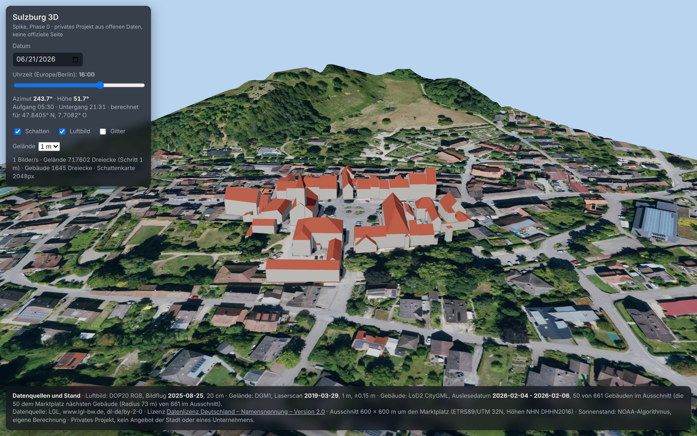

# Sulzburg 3D · Spike (Phase 0)

Privater Prototyp: der Ortskern von Sulzburg (Landkreis Breisgau-Hochschwarzwald) als begehbares 3D-Modell im Browser, gebaut aus offenen Geodaten des Landes Baden-Württemberg. Kein Angebot der Stadt Sulzburg und keines Unternehmens. Kein Wappen, kein Logo.

Phase 0 klärt die technischen Kernfragen: Sind die Daten offen abrufbar, passen Gelände, Luftbild und Gebäude zusammen, läuft es im Browser ohne Grafikkarte.



## Was der Prototyp zeigt

- Gelände aus dem amtlichen Höhenmodell DGM1 (1 m Raster), Ausschnitt 600 × 600 m um den Marktplatz
- Luftbild DOP20 (20 cm) als Textur auf dem Gelände
- 50 Gebäude als LoD2-Modelle mit echten Dachformen (die 50 dem Marktplatz nächsten von 661 im Ausschnitt)
- Sonnenstand für Datum und Uhrzeit mit Schattenwurf von Gebäuden und Gelände
- Klick auf ein Gebäude: Adresse, Gebäudefunktion, Dachform, Höhe, Bodenhöhe aus LoD2 und DGM1
- Quellen und Datenstand jeder Ebene direkt in der Anwendung

## Starten

Es gibt keinen Build-Schritt. Die Anwendung besteht aus statischen Dateien und läuft offline.

```bash
cd web
python3 -m http.server 8123
# dann im Browser: http://localhost:8123/
```

Ein lokaler Webserver ist nötig, weil der Browser Module und Binärdaten nicht direkt aus dem Dateisystem lädt.

Parameter in der URL für reproduzierbare Ansichten: `?t=2026-06-21T18:30` (lokale Zeit), `&cam=-40,60,110` (Kamera relativ zum Marktplatz: Ost, Höhe, Süd), `&step=2` (Geländeauflösung 2 m), `&shadow=4096` (Schattenkarte).

## Struktur

```
scripts/   Datenpipeline (Python, reproduzierbar)
  common.py          Ausschnitt, Pfade, Lizenz
  01_download.py     LGL-Kacheln laden, Prüfsummen und Server-Datum protokollieren
  02_terrain.py      DGM1 (XYZ) -> web/data/terrain.bin + terrain.json
  03_orthophoto.py   DOP20 (TIFF + TFW) -> web/data/ortho.jpg + ortho.json
  04_buildings.py    LoD2 (CityGML) -> web/data/buildings.glb + buildings.json
  05_validate.py     Gebäude gegen Gelände, Sonnenstand gegen Referenz -> docs/validierung.md
data/
  sources.json       Protokoll aller Downloads und Ebenen (URL, SHA-256, Datenstand)
  codelisten/        amtliche AdV-Codelisten (Dachform, Gebäudefunktion)
  raw/               Rohdaten des LGL (nicht im Git, 245 MB, per 01_download.py neu ladbar)
web/
  index.html, app.js, sun.js, style.css   Anwendung (three.js, ES-Module, kein Build)
  data/              aufbereitete Daten (ca. 4,5 MB)
  vendor/three/      three.js 0.187.0 (MIT), lokal eingebunden
docs/                Screenshots, Validierungsbericht
```

## Datenquellen, Lizenzen, Datenstände

Alle Geodaten stammen vom Landesamt für Geoinformation und Landentwicklung Baden-Württemberg (LGL) über das [Open GeoData Portal](https://opengeodata.lgl-bw.de/). Lizenz: [Datenlizenz Deutschland – Namensnennung – Version 2.0](https://www.govdata.de/dl-de/by-2-0). Vorgeschriebene Namensnennung: **„Datenquelle: LGL, www.lgl-bw.de, dl-de/by-2-0“**. Koordinaten ETRS89/UTM 32N (EPSG:25832), Höhen NHN (DHHN2016). Alle Kacheln heruntergeladen am 08.11.2026, Prüfsummen in `data/sources.json`.

| Ebene | Produkt | Kachel | Datenstand (aus den Metadaten der Lieferung) | Stand auf dem Server |
|---|---|---|---|---|
| Luftbild | DOP20 RGB, TrueDOP, 20 cm, Kamera Leica DMC-4 | `dop20rgb_32_403_5298_2_bw.zip` (227,6 MB), genutzt: Teilkachel 403_5299 | Bildflug **25.08.2025** | 26.03.2026 |
| Gelände | DGM1, 1 m Raster, Höhengenauigkeit ±0,15 m | `dgm1_32_403_5298_2_bw.zip` (15,5 MB), genutzt: Teilkachel 403_5299 | Laserscan **29.03.2019** | 18.07.2026 |
| Gebäude | LoD2, CityGML 1.0, Gemeindeschlüssel 08315111 | `LoD2_32_403_5298_2_bw.zip` (2,7 MB), genutzt: `LoD2_32_403_5299_1_BW.gml` | Auslesedatum **04. bis 06.02.2026**, Aktualität ALKIS LoD2 01.04.2025, ATKIS Bauwerke 22.09.2025, Modelle erstellt (creationDate der 50 Gebäude) 18.11.2025 | 20.04.2026 |

Weitere Quellen:

| Zweck | Quelle | Lizenz / Hinweis |
|---|---|---|
| Bezeichnungen der Codes für Dachform und Gebäudefunktion | AdV-Codelisten `RoofTypeTypeAdV.xml`, `BuildingFunctionTypeAdV.xml` von repository.gdi-de.org (Gebäudefunktion, Stand laut Datei 09.04.2024) | AdV, Kopie in `data/codelisten/` |
| Mittelpunkt des Ausschnitts (Marktplatz, 47,84052° N, 7,70817° O) | OpenStreetMap über Nominatim, Abfrage 08.11.2026 | © OpenStreetMap-Mitwirkende, ODbL. Nur zur Wahl des Ausschnitts, keine Datenebene |
| Sonnenstand | eigene Berechnung nach dem NOAA-Algorithmus (`web/sun.js`) | geprüft gegen die Python-Bibliothek astral, siehe Validierung |
| 3D-Darstellung | [three.js](https://threejs.org/) 0.187.0 | MIT, `web/vendor/three/LICENSE` |

Nicht genutzt, aber im selben Portal frei verfügbar und für spätere Phasen relevant: DGM025 (25 cm), DOM1, nDOM1, LoD1, Hauskoordinaten, Hausumringe, Verwaltungsgrenzen (ALKIS), DOP20 RGBI.

## Pipeline nachvollziehen

```bash
pip install numpy pyproj shapely lxml pillow tifffile mapbox_earcut astral
python3 -I scripts/01_download.py      # lädt die drei Kacheln (ca. 245 MB)
python3 -I scripts/02_terrain.py
python3 -I scripts/03_orthophoto.py
python3 -I scripts/04_buildings.py     # --count 100 oder --all für mehr Gebäude
python3 -I scripts/05_validate.py
```

Ausschnitt und Gebäudezahl stehen in `scripts/common.py`. Die ganze Kette läuft in unter zehn Sekunden.

## Validierung (Stand 08.11.2026, Details in `docs/validierung.md`)

**Gebäude gegen Gelände.** 369 Eckpunkte der LoD2-Bodenflächen wurden mit der DGM1-Höhe an derselben Stelle verglichen. Mittlere Abweichung −0,41 m, 58 % innerhalb ±0,5 m, 83 % innerhalb ±1,0 m. Kein Gebäude schwebt: Die größte positive Abweichung eines regulären Bodenpunkts liegt bei +0,04 m. Die einzige große positive Abweichung (+13,3 m) ist die Bodenfläche des Turm-Bauteils am Museum Hauptstraße 56, die bewusst auf dem Dach sitzt. Negative Werte entstehen, weil das LGL die Gebäudeböden am tiefsten Geländepunkt des Grundrisses ansetzt; am Hang stecken die Wände deshalb bis zu 3 m im Gelände. Das ist gewollt und sieht richtig aus.

**Sonnenstand.** Auf- und Untergangszeiten weichen höchstens 0,8 Minuten von astral ab, Azimut und Höhe stimmen numerisch überein. Einschränkung: astral nutzt dieselben NOAA-Formeln, der Test prüft also die Umsetzung, nicht die Methode. Stichprobe Sulzburg 21.06.2026: Aufgang 05:30, Untergang 21:31 Uhr (MESZ).

**Lage.** Die Gebäude liegen im Luftbild dort, wo das Luftbild sie zeigt (Sichtprüfung am Marktplatz, Kirche, Rathaus). Ein systematischer Abgleich an 20 Gebäuden folgt in Phase 1.

## Ehrliche Einschätzung nach Phase 0

Was gut läuft:

- Alle drei Kernquellen sind offen, kostenlos, ohne Anmeldung und in einer Lizenz. Die 2-km-Kacheln lassen sich per URL laden, die Dateinamen stecken im Gitter des Portals.
- Die Daten passen zusammen. LoD2 ist aus demselben DGM abgeleitet, Gebäude stehen ohne Korrektur richtig auf dem Gelände.
- Die LoD2-Daten enthalten mehr als erwartet: Adresse, Gebäudefunktion (Rathaus, Museum, Stadtmauer, Wohnhaus), Dachform, Grundriss-Stand pro Gebäude.
- Eigene Umsetzung in three.js statt CesiumJS oder MapLibre: kein Schlüssel, kein Dienst, kein Build, vollständige Kontrolle über Sonne und Schatten, läuft auf GitHub Pages.

Was hakt oder offen ist:

- **Performance ist nicht auf echter Hardware gemessen.** Hier gibt es nur Software-Rendering (1 bis 10 Bilder/s). Das Gelände hat 718 000 Dreiecke bei 1 m Auflösung. Auf einem Laptop mit integrierter Grafik sollte das reichen, sicher ist es erst nach einem Test. Fallback: Gelände auf 2 m oder 4 m stellen (Schalter in der Anwendung).
- **Das Höhenmodell ist von 2019**, Luftbild und Gebäude von 2025. Für den Ortskern unkritisch, bei Neubaugebieten kann es sichtbar werden.
- Im Luftbild sind alle Dächer zu sehen, als 3D-Modell nur 50. Das wirkt im Spike bewusst unvollständig; `--all` liefert alle 661 Gebäude des Ausschnitts.
- Gebäude haben keine Texturen und keine Fenster, nur Dachfarbe und Wandfarbe. Das ist Stilentscheidung, keine Datenlücke.
- Die Vorlage „Niedergörsdorf in 3D“ aus dem LinkedIn-Post war per Websuche nicht auffindbar. Der Link aus den Kommentaren fehlt weiterhin.
- Dieses Projekt liegt vorerst als Unterordner in einem fremden Repository. Das Konzept verlangt ein eigenes Repository; der Ordner ist dafür in sich geschlossen.

## Offene Entscheidungen für Phase 1

1. Eigenes Repository anlegen und diesen Ordner dorthin verschieben.
2. Ausdehnung auf die ganze Gemeinde: Gelände dann gekachelt oder in 2 bis 5 m, Luftbild in Kacheln (die Gemeinde umfasst grob 8 bis 10 LGL-Kacheln, rund 2 GB Rohdaten).
3. Variante A (privat) oder B (mit Kommunikation), siehe Konzept.
